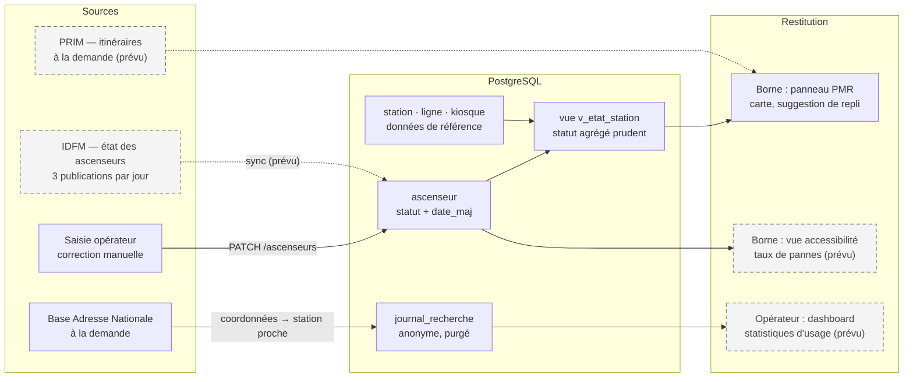

# Movecity — Choix de données (v3)

> Ce document justifie **quelles données** la borne utilise, **d'où** elles viennent, **comment** elles sont stockées, et **ce que nous choisissons de ne pas collecter**.

## 1. Les quatre familles de données

| Famille | Exemples | Stockage | Durée de vie |
|---|---|---|---|
| **Référence** | stations, lignes, borne, lignes affichées | PostgreSQL (`station`, `ligne`, `kiosque`…) | Stable ; modifiée par l'opérateur |
| **Dynamique** | état des ascenseurs | PostgreSQL (`ascenseur`) | Rafraîchie ~3 fois par jour |
| **Usage anonyme** | station la plus proche d'une recherche, langue, heure | PostgreSQL (`journal_recherche`) | Purgée (90 j proposés) |
| **À la demande (externes)** | adresse → coordonnées, itinéraires, fond de carte | Rien n'est conservé | Le temps de la requête |

## 2. Sources de données

| Source | Fournisseur | Ce qu'on en tire | Accès | Fréquence | Limites et risques | État |
|---|---|---|---|---|---|---|
| **État des ascenseurs** | Île-de-France Mobilités (data.gouv.fr / portail open data IDFM) | Statut de chaque ascenseur, rattaché à une zone de correspondance | Fichiers CSV / JSON en téléchargement | **Collectée et publiée 3 fois par jour**, d'après la fiche du jeu de données | Issue de **tournées d'agents RATP/SNCF en gare** : ce n'est pas du temps réel. Licence : la fiche indique « non spécifiée » et le pied de page du portail annonce la Licence Ouverte 2.0 → **à confirmer** | Prévu. En base : données de démonstration |
| **Calculateur d'itinéraires** | PRIM (IDFM), API « Navitia » | Itinéraire entre deux points | Compte PRIM + CGU ; données sous « Licence Mobilité » | À la demande | Quota selon l'ancienneté du compte (la page indique **1 000 requêtes/jour** pour les comptes récents) → **à vérifier sur notre compte** ; prévoir un cache. Option PMR (fauteuil) **non vérifiée** | Prévu |
| **Base Adresse Nationale** | État (api-adresse.data.gouv.fr) | Adresse tapée → coordonnées | Gratuit, sans clé | À la demande | Dépend d'internet ; l'adresse tapée est transmise à ce service (non stockée par nous) | **Intégré** |
| **Fond de carte** | OpenStreetMap (tuiles) | Affichage de la carte | Gratuit, attribution obligatoire | À la demande | Politique d'usage des tuiles à respecter pour un vrai déploiement | **Intégré** |
| **Données internes** | Équipe | Station pilote, lignes, position de la borne | `server/db/seed.sql` | Manuelle | Coordonnées réelles à ~30 m près, à vérifier avec le référentiel d'arrêts IDFM | **Intégré** |

## 3. Pourquoi ces choix

- **Ne pas stocker de géométries ni d'horaires** : le calcul d'itinéraire et les horaires appartiennent à PRIM. Les recoder serait coûteux et faux au bout de quelques semaines.
- **Stocker l'état des ascenseurs** plutôt que le réinterroger à chaque affichage : la source n'est publiée que 3 fois par jour ; une copie locale rend la borne **réactive et résistante aux pannes de la source**, et conserve la date de dernière mise à jour.
- **Un identifiant externe (`ref_externe`)** sur chaque ascenseur : clé de rapprochement pour une synchronisation idempotente (mise à jour sans doublon).
- **`DOUBLE PRECISION` pour latitude/longitude** (et non du texte) : calculs de distance et tris directement en SQL.
- **Un statut à trois valeurs** (`disponible`, `en_panne`, `inconnu`) : l'absence d'information n'est jamais présentée comme une bonne nouvelle.

## 4. Qualité et fraîcheur

| Règle | Application |
|---|---|
| La date de mise à jour est toujours affichée à côté du statut | `ElevatorPanel` |
| Pas d'information = **inconnu** (jamais « disponible » par défaut) | Vue `v_etat_station`, front |
| Agrégation prudente par station : panne > inconnu > disponible | Vue SQL + `agregerStatut()` (testée) |
| Donnée de plus de 24 h = avertissement « demandez confirmation à un agent » | `config.ts` → `DONNEE_ANCIENNE_HEURES` |
| Une panne est rattachée à **toutes** les lignes qui desservent la station | Statistiques « pannes par ligne » : approximation à expliquer au jury |

**Synchronisation (implémentée)** — `server/src/sync/` :

| Étape | Règle |
|---|---|
| Lecture | API Opendatasoft du jeu « État des ascenseurs » (pagination 100), ou fichier CSV/JSON local en secours (`IDFM_FILE` / `--file`) |
| Statuts | `available` → *disponible* ; `notavailable` → *en_panne* (motif : `liftFailure` → « Panne technique », `closedForMaintenance` → « Fermé pour travaux / maintenance », autre → « Autre problème d'équipement ») ; `unknown` et toute valeur inattendue → *inconnu* |
| Date | `date_maj` = `liftStateUpdate` (date du relevé IDFM, **pas** l'heure de la synchronisation). Date absente ou invalide → on conserve l'ancienne, on ne simule pas de fraîcheur |
| Clé d'ascenseur | `ascenseur.ref_externe` = `liftId` → *upsert* idempotent |
| Rattachement à nos stations | `ZdCId` (zone de correspondance) → `station.ref_zdc`, mémorisé à la première association. Première association : nom normalisé identique (sans accents/casse/ponctuation), sinon table d'alias `alias-stations.json`. **Jamais de correspondance approximative** : afficher l'état d'une autre station serait pire qu'afficher « inconnu » |
| Ascenseur disparu du flux | passe en *inconnu* (jamais en *disponible*) |
| Flux vide ou illisible | synchronisation annulée, base inchangée (le dernier état connu reste affiché) |
| Données de démonstration | `DEMO-n` supprimés pour les stations couvertes par de vraies données ; `--purge-demo` pour tout supprimer |
| Fréquence | `IDFM_SYNC_ACTIVE=true` : au démarrage puis toutes les 180 min (minimum 30), la source étant publiée ~3 fois par jour |
| Emplacement | `ascenseur.libelle` = `liftSituation → liftDirection`, exposé par l'API (utile à une personne en fauteuil pour savoir **quel** ascenseur) |

Commandes : `npm run sync:ascenseurs -- --dry-run` (simulation et diagnostic du rapprochement), puis `npm run sync:ascenseurs`.

## 5. Protection des données (RGPD)

| Donnée | Stockée ? | Durée | Justification |
|---|---|---|---|
| Adresse tapée par le citoyen | **Non** | — | Peut révéler un domicile ou un lieu de soin |
| Coordonnées de l'adresse | **Non** | — | Idem |
| Station la plus proche d'une recherche | Oui (journal) | 90 j (à valider) | Statistique d'usage non identifiante |
| Langue de l'interface | Oui (journal) | 90 j | Statistique non identifiante |
| Horodatage de la recherche | Oui (journal) | 90 j | Affluence par heure |
| Identité, favoris, historique de trajets du citoyen | **Non — n'existent pas** | — | Borne anonyme par conception |
| E-mail et hash du mot de passe de l'opérateur | Oui | Durée du contrat | Authentification (hash bcrypt, jamais en clair) |

Le journal n'est lié à **aucune personne** : une ligne dit « une recherche près de Hôtel de Ville, en anglais, à 14 h ». La seule donnée personnelle traitée est celle de l'opérateur.

## 6. Choix écartés

| Idée | Pourquoi écartée |
|---|---|
| Compte citoyen, favoris, trajets enregistrés | Contraire à l'anonymat décidé par l'équipe |
| Géolocalisation du navigateur | La borne est fixe : sa position réelle est connue (table `kiosque`) |
| Stocker l'adresse pour « améliorer le service » | Collecte inutile et risquée ; la station proche suffit aux statistiques |
| Réinterroger IDFM à chaque affichage | Inutile (3 publications/jour), fragile, consomme le quota |

## 7. Hypothèses à valider avec l'équipe

1. Durée de conservation du journal (90 jours) — **filière Cybersécurité**.
2. Licence exacte du jeu « État des ascenseurs » et mentions d'attribution — **Marketing / Juridique**.
3. Quota PRIM réel du compte de l'équipe et disponibilité de l'option « fauteuil roulant ».
4. Hébergement et région du serveur (données hébergées dans l'UE).
